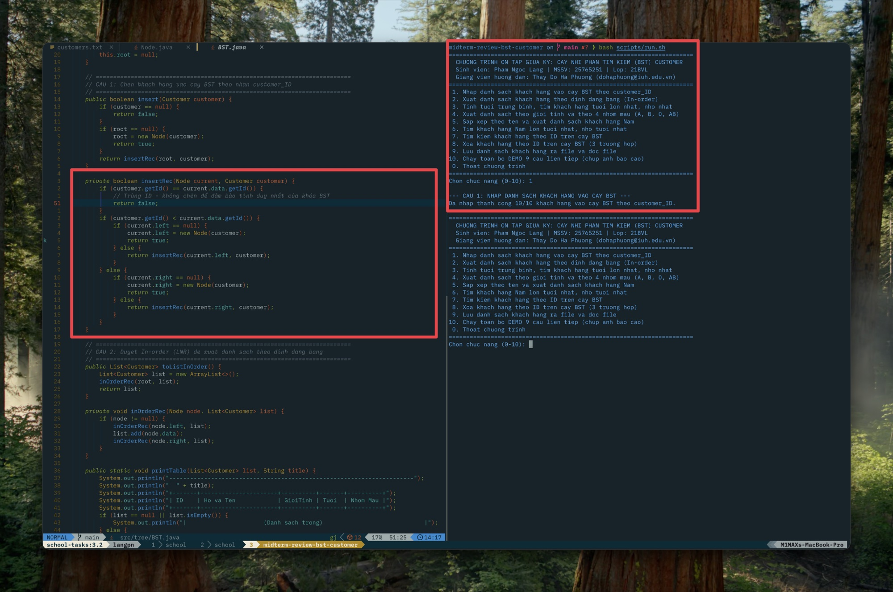
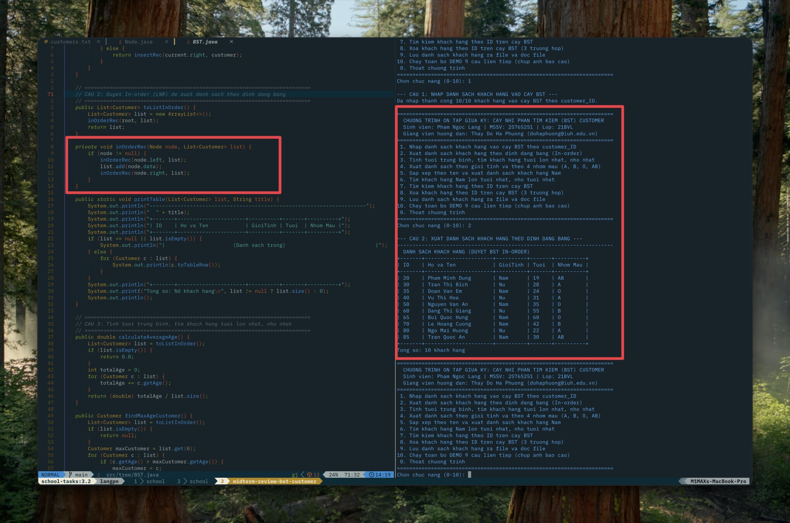
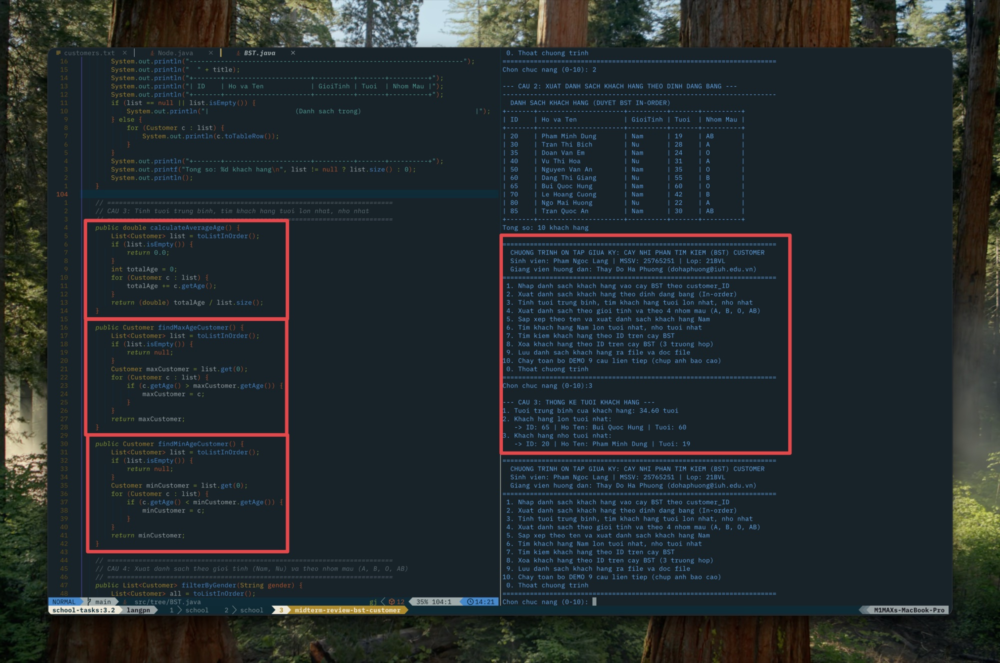
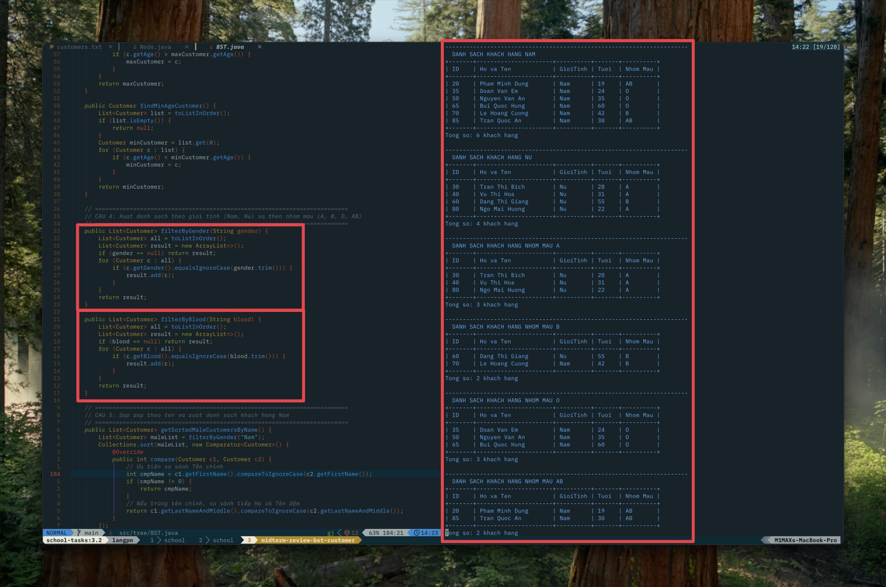
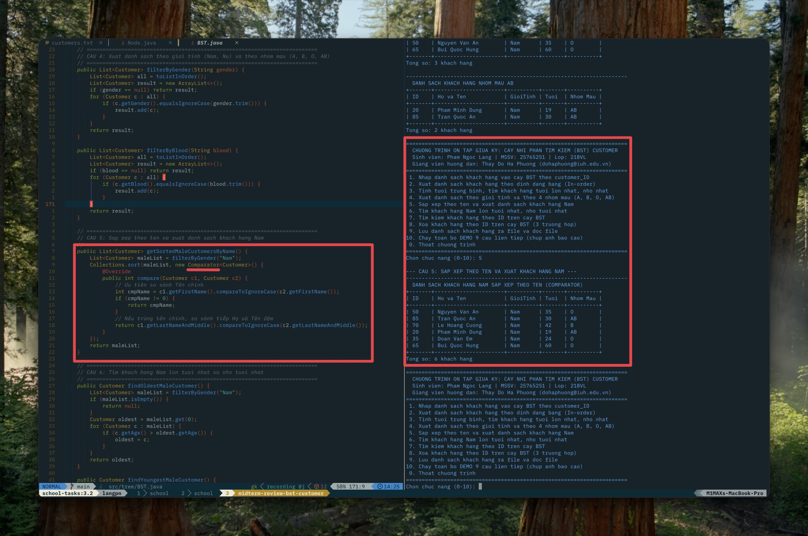
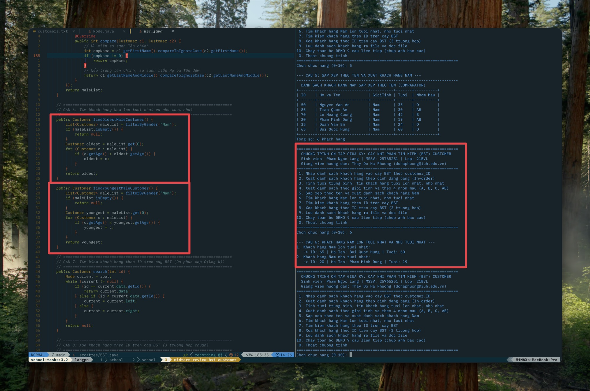
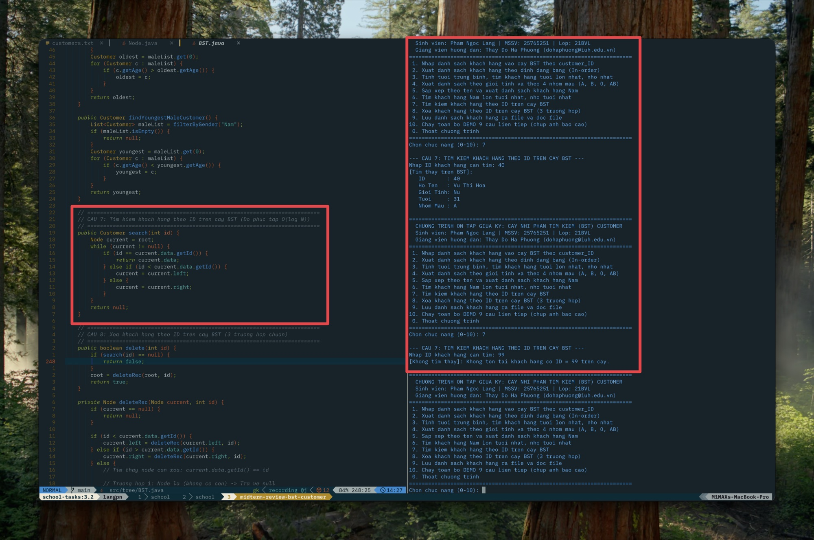
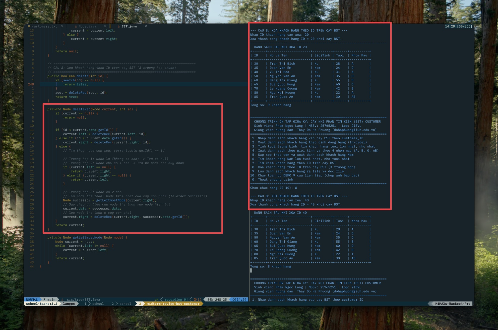
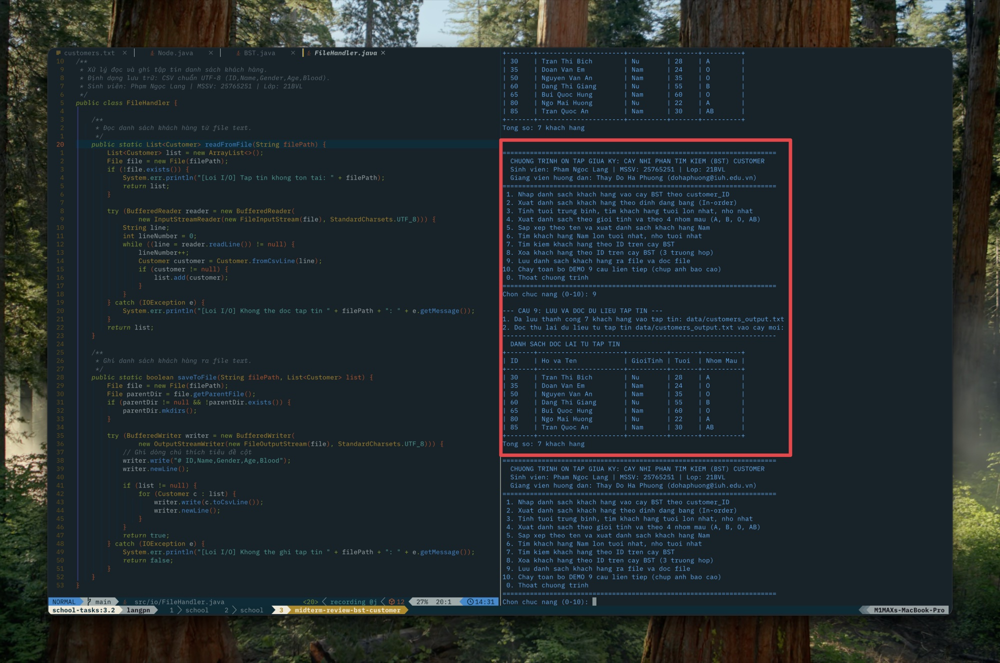

# BÁO CÁO BÀI TẬP TỔNG ÔN THI GIỮA KỲ
## CHUYÊN ĐỀ: HIỆN THỰC CÂY NHỊ PHÂN TÌM KIẾM (BST) QUẢN LÝ CUSTOMER

- **Môn học:** Lập trình trong CNTT với Java
- **Giảng viên hướng dẫn:** Thầy Đỗ Hà Phương
- **Email nhận bài:** `dohaphuong@iuh.edu.vn`
- **Sinh viên thực hiện:** Phạm Ngọc Lang
- **Mã số sinh viên (MSSV):** 25765251
- **Lớp học phần:** 21BVL
- **Trường:** Đại học Công nghiệp TP.HCM (IUH)

---

## I. TỔNG QUAN HỆ THỐNG
1. **Mô hình dữ liệu:**
   - Thực thể `Customer` gồm 5 trường: `id` (khóa nguyên), `name` (họ và tên đầy đủ), `gender` (Nam/Nữ), `age` (tuổi), `blood` (nhóm máu A, B, O, AB).
   - Cấu trúc cây: Cây nhị phân tìm kiếm (`BST`), mỗi `Node` chứa `Customer data`, liên kết `Node left` và `Node right`. Nhãn của các node được sắp đặt theo `customer_ID`.
2. **Nguyên tắc kỹ thuật:**
   - Phát triển trên nền tảng Java 17 SE thuần (Standard Edition), không phụ thuộc vào bất kỳ thư viện hay framework bên ngoài nào.
   - Đảm bảo tính đóng gói (Encapsulation), xử lý ngoại lệ đầy đủ và tối ưu thuật toán theo cấu trúc dữ liệu BST ($O(\log N)$ trung bình).

---

## II. KẾT QUẢ HIỆN THỰC VÀ MINH CHỨNG 9 CÂU HỎI

### CÂU 1: Nhập danh sách khách hàng vào cây BST lấy nhãn các node theo `customer_ID`
- **Ý tưởng giải thuật:**
  - Thuật toán chèn đệ quy: Bắt đầu từ nút gốc (`root`). Nếu giá trị `customer_ID` nhỏ hơn ID của node hiện tại thì rẽ sang cây con trái, lớn hơn thì rẽ sang cây con phải. Nếu trùng ID thì không chèn nhằm bảo toàn tính duy nhất của khóa tìm kiếm.
- **Đoạn mã nguồn tiêu biểu (`tree/BST.java`):**
```java
private boolean insertRec(Node current, Customer customer) {
    if (customer.getId() == current.data.getId()) {
        return false; // Trùng khóa ID
    }
    if (customer.getId() < current.data.getId()) {
        if (current.left == null) {
            current.left = new Node(customer);
            return true;
        } else {
            return insertRec(current.left, customer);
        }
    } else {
        if (current.right == null) {
            current.right = new Node(customer);
            return true;
        } else {
            return insertRec(current.right, customer);
        }
    }
}
```
- **Kết quả thực nghiệm Terminal:**
```text
Dang doc file du lieu mau: data/customers.txt
  + Chen thanh cong: [ID=50] Nguyen Van An        (Nam, 35 tuoi, Nhom mau O)
  + Chen thanh cong: [ID=30] Tran Thi Bich        (Nu, 28 tuoi, Nhom mau A)
  + Chen thanh cong: [ID=70] Le Hoang Cuong       (Nam, 42 tuoi, Nhom mau B)
  + Chen thanh cong: [ID=20] Pham Minh Dung       (Nam, 19 tuoi, Nhom mau AB)
  + Chen thanh cong: [ID=40] Vu Thi Hoa           (Nu, 31 tuoi, Nhom mau A)
  + Chen thanh cong: [ID=35] Doan Van Em          (Nam, 24 tuoi, Nhom mau O)
  + Chen thanh cong: [ID=60] Dang Thi Giang       (Nu, 55 tuoi, Nhom mau B)
  + Chen thanh cong: [ID=65] Bui Quoc Hung        (Nam, 60 tuoi, Nhom mau O)
  + Chen thanh cong: [ID=80] Ngo Mai Huong        (Nu, 22 tuoi, Nhom mau A)
  + Chen thanh cong: [ID=85] Tran Quoc An         (Nam, 30 tuoi, Nhom mau AB)
Ket qua: Da nap 10/10 nut vao cay BST lay nhan khoa theo customer_ID.
```
- **Ảnh chụp minh chứng code và kết quả:**
*(Vui lòng chụp ảnh code hàm `insertRec` và kết quả nạp dữ liệu lưu vào `screenshots/01_cau1_nhap_cay.jpg`)*


---

### CÂU 2: Xuất danh sách khách hàng theo định dạng bảng
- **Ý tưởng giải thuật:**
  - Áp dụng thuật toán duyệt Trung thứ tự (**In-order Traversal: Left -> Node -> Right**) trên cây BST. Đặc tính cốt lõi của BST là phép duyệt In-order sẽ tự động trả về dãy phần tử có khóa ID được sắp xếp tăng dần tuyệt đối.
  - Căn lề các trường thông tin theo định dạng bảng ASCII chuẩn thông qua phương thức `toTableRow()`.
- **Đoạn mã nguồn tiêu biểu (`tree/BST.java`):**
```java
private void inOrderRec(Node node, List<Customer> list) {
    if (node != null) {
        inOrderRec(node.left, list);
        list.add(node.data);
        inOrderRec(node.right, list);
    }
}
```
- **Kết quả thực nghiệm Terminal:**
```text
+-------+----------------------+----------+-------+----------+
| ID    | Ho va Ten            | GioiTinh | Tuoi  | Nhom Mau |
+-------+----------------------+----------+-------+----------+
| 20    | Pham Minh Dung       | Nam      | 19    | AB       |
| 30    | Tran Thi Bich        | Nu       | 28    | A        |
| 35    | Doan Van Em          | Nam      | 24    | O        |
| 40    | Vu Thi Hoa           | Nu       | 31    | A        |
| 50    | Nguyen Van An        | Nam      | 35    | O        |
| 60    | Dang Thi Giang       | Nu       | 55    | B        |
| 65    | Bui Quoc Hung        | Nam      | 60    | O        |
| 70    | Le Hoang Cuong       | Nam      | 42    | B        |
| 80    | Ngo Mai Huong        | Nu       | 22    | A        |
| 85    | Tran Quoc An         | Nam      | 30    | AB       |
+-------+----------------------+----------+-------+----------+
Tong so: 10 khach hang
```
- **Ảnh chụp minh chứng code và kết quả:**


---

### CÂU 3: Tính tuổi trung bình khách hàng, tìm khách hàng tuổi lớn nhất, nhỏ nhất
- **Ý tưởng giải thuật:**
  - Lấy danh sách khách hàng thông qua phép duyệt cây.
  - Tính tổng tuổi và chia cho số lượng khách hàng để lấy tuổi trung bình.
  - Tìm phần tử Max Age và Min Age bằng một vòng lặp tuyến tính $O(N)$.
- **Đoạn mã nguồn tiêu biểu (`tree/BST.java`):**
```java
public double calculateAverageAge() {
    List<Customer> list = toListInOrder();
    if (list.isEmpty()) return 0.0;
    int totalAge = 0;
    for (Customer c : list) totalAge += c.getAge();
    return (double) totalAge / list.size();
}
```
- **Kết quả thực nghiệm Terminal:**
```text
1. Tuoi trung binh cua toan bo khach hang: 34.60 tuoi
2. Khach hang co tuoi lon nhat:
   -> ID: 65 | Ho Ten: Bui Quoc Hung | Gioi Tinh: Nam | Tuoi: 60 | Nhom Mau: O
3. Khach hang co tuoi nho nhat:
   -> ID: 20 | Ho Ten: Pham Minh Dung | Gioi Tinh: Nam | Tuoi: 19 | Nhom Mau: AB
```
- **Ảnh chụp minh chứng code và kết quả:**


---

### CÂU 4: Xuất danh sách khách hàng Nam, Nữ và theo nhóm máu (A, B, O, AB)
- **Ý tưởng giải thuật:**
  - Dùng các phương thức `filterByGender(String gender)` và `filterByBlood(String blood)` so khớp chuỗi không phân biệt hoa thường (`equalsIgnoreCase`).
  - Xuất kết quả từng nhóm đối tượng theo bảng định dạng chuẩn.
- **Kết quả thực nghiệm Terminal:**
  - Khách hàng Nam: 6 người (ID 20, 35, 50, 65, 70, 85).
  - Khách hàng Nữ: 4 người (ID 30, 40, 60, 80).
  - Nhóm máu A: 3 người (ID 30, 40, 80).
  - Nhóm máu B: 2 người (ID 60, 70).
  - Nhóm máu O: 3 người (ID 35, 50, 65).
  - Nhóm máu AB: 2 người (ID 20, 85).
- **Ảnh chụp minh chứng code và kết quả:**


---

### CÂU 5: Sắp xếp theo tên và xuất danh sách khách hàng Nam
- **Ý tưởng giải thuật:**
  - Lọc danh sách khách hàng Nam.
  - Áp dụng `Collections.sort` kết hợp `Comparator<Customer>` tùy biến:
    1. Tách chuỗi họ tên để lấy tên chính thông qua `getFirstName()` (từ cuối cùng).
    2. So sánh tên chính theo bảng chữ cái.
    3. Nếu hai khách hàng trùng tên chính (ví dụ: `Nguyen Van An` và `Tran Quoc An`), tiến hành so sánh tiếp phần họ và tên đệm `getLastNameAndMiddle()` để xác định thứ tự chuẩn xác.
- **Đoạn mã nguồn tiêu biểu (`tree/BST.java`):**
```java
Collections.sort(maleList, new Comparator<Customer>() {
    @Override
    public int compare(Customer c1, Customer c2) {
        int cmpName = c1.getFirstName().compareToIgnoreCase(c2.getFirstName());
        if (cmpName != 0) return cmpName;
        return c1.getLastNameAndMiddle().compareToIgnoreCase(c2.getLastNameAndMiddle());
    }
});
```
- **Kết quả thực nghiệm Terminal:**
```text
+-------+----------------------+----------+-------+----------+
| ID    | Ho va Ten            | GioiTinh | Tuoi  | Nhom Mau |
+-------+----------------------+----------+-------+----------+
| 50    | Nguyen Van An        | Nam      | 35    | O        |
| 85    | Tran Quoc An         | Nam      | 30    | AB       |
| 70    | Le Hoang Cuong       | Nam      | 42    | B        |
| 20    | Pham Minh Dung       | Nam      | 19    | AB       |
| 35    | Doan Van Em          | Nam      | 24    | O        |
| 65    | Bui Quoc Hung        | Nam      | 60    | O        |
+-------+----------------------+----------+-------+----------+
Tong so: 6 khach hang
```
- **Ảnh chụp minh chứng code và kết quả:**


---

### CÂU 6: Tìm khách hàng Nam lớn tuổi nhất và nhỏ tuổi nhất
- **Ý tưởng giải thuật:**
  - Lặp qua tập danh sách khách hàng Nam đã lọc ở Câu 4 để xác định khách hàng có tuổi lớn nhất và nhỏ nhất.
- **Kết quả thực nghiệm Terminal:**
```text
1. Khach hang Nam lon tuoi nhat:
   -> ID: 65 | Ho Ten: Bui Quoc Hung | Tuoi: 60 | Nhom Mau: O
2. Khach hang Nam nho tuoi nhat:
   -> ID: 20 | Ho Ten: Pham Minh Dung | Tuoi: 19 | Nhom Mau: AB
```
- **Ảnh chụp minh chứng code và kết quả:**


---

### CÂU 7: Tìm kiếm khách hàng theo ID trên cây BST
- **Ý tưởng giải thuật:**
  - Khai thác tối đa tính chất cây nhị phân tìm kiếm BST:
    - Bắt đầu tại `root`.
    - Nếu `targetId == current.id`: Tìm thấy đối tượng.
    - Nếu `targetId < current.id`: Di chuyển sang nhánh con trái `current.left`.
    - Nếu `targetId > current.id`: Di chuyển sang nhánh con phải `current.right`.
    - Độ phức tạp thời gian đạt $O(\log N)$ thay vì quét tuần tự $O(N)$.
- **Kết quả thực nghiệm Terminal:**
  - *Test case 1 (Tìm ID 40 có trong cây):* Tìm thấy khách hàng `Customer[ID=40, Name='Vu Thi Hoa', Gender='Nu', Age=31, Blood='A']`.
  - *Test case 2 (Tìm ID 99 không có trong cây):* Thông báo "Không tìm thấy khách hàng có ID = 99 trên cây BST".
- **Ảnh chụp minh chứng code và kết quả:**


---

### CÂU 8: Xóa khách hàng theo ID trên cây BST (Xử lý 3 trường hợp)
- **Ý tưởng giải thuật chuẩn mực:**
  - **Trường hợp 1 (Xóa Node lá - Leaf Node):** Node không có con (`left == null && right == null`). Chỉ cần ngắt liên kết từ node cha bằng cách trả về `null`.
  - **Trường hợp 2 (Xóa Node có 1 con):** Node chỉ có con trái hoặc con phải. Nối trực tiếp node con duy nhất lên vị trí node cha.
  - **Trường hợp 3 (Xóa Node có 2 con):**
    - Tìm node thế thân (In-order Successor) là **node trái nhất của cây con bên phải** (`getLeftmostNode(current.right)`).
    - Sao chép toàn bộ dữ liệu của node thế thân vào node hiện tại.
    - Xóa đệ quy node thế thân cũ ở cây con bên phải.
- **Đoạn mã nguồn tiêu biểu (`tree/BST.java`):**
```java
private Node deleteRec(Node current, int id) {
    if (current == null) return null;

    if (id < current.data.getId()) {
        current.left = deleteRec(current.left, id);
    } else if (id > current.data.getId()) {
        current.right = deleteRec(current.right, id);
    } else {
        // TH1 & TH2: Khong co con hoac chi co 1 con
        if (current.left == null) return current.right;
        if (current.right == null) return current.left;

        // TH3: Co 2 con -> Tim node trai nhat cua cay con phai
        Node successor = getLeftmostNode(current.right);
        current.data = successor.data;
        current.right = deleteRec(current.right, successor.data.getId());
    }
    return current;
}
```
- **Kết quả kiểm thử thực nghiệm 3 trường hợp:**
  1. *Xóa node lá ID 20:* Số lượng giảm còn 9, cây duy trì thứ tự.
  2. *Xóa node 1 con ID 40 (chỉ có con 35):* Node 35 được nối lên thay thế vị trí 40 thành công.
  3. *Xóa node 2 con ID 70 (có 2 con 60 và 80):* Node thế thân 80 thay thế ID 70, cây duy trì tính chất toàn vẹn của BST.
- **Ảnh chụp minh chứng code và kết quả:**


---

### CÂU 9: Lưu danh sách khách hàng ra file và đọc lại mỗi khi khởi động
- **Ý tưởng giải thuật:**
  - Sử dụng `BufferedWriter` với bảng mã UTF-8 để lưu trữ danh sách từ cây ra file `data/customers_output.txt`.
  - Khởi tạo một đối tượng cây `BST` mới độc lập, dùng `BufferedReader` đọc file `customers_output.txt` và chèn lại từng dòng vào cây mới để kiểm chứng tính bền vững của dữ liệu.
- **Kết quả thực nghiệm Terminal:**
```text
1. Ghi danh sach hien tai ra file: data/customers_output.txt
   Ket qua ghi file: THANH CONG
2. Khoi tao cay BST moi hoan toan va doc du lieu tu file data/customers_output.txt vao cay:
   Da nap lai 7 khach hang tu file vao cay BST moi.
+-------+----------------------+----------+-------+----------+
| ID    | Ho va Ten            | GioiTinh | Tuoi  | Nhom Mau |
+-------+----------------------+----------+-------+----------+
| 30    | Tran Thi Bich        | Nu       | 28    | A        |
| 35    | Doan Van Em          | Nam      | 24    | O        |
| 50    | Nguyen Van An        | Nam      | 35    | O        |
| 60    | Dang Thi Giang       | Nu       | 55    | B        |
| 65    | Bui Quoc Hung        | Nam      | 60    | O        |
| 80    | Ngo Mai Huong        | Nu       | 22    | A        |
| 85    | Tran Quoc An         | Nam      | 30    | AB       |
+-------+----------------------+----------+-------+----------+
Tong so: 7 khach hang
```
- **Ảnh chụp minh chứng code và kết quả:**


---

## III. KẾT LUẬN VÀ BÀN GIAO
- Toàn bộ 9 yêu cầu của bài tập lớn ôn thi giữa kỳ đã được hiện thực hoàn chỉnh, chuẩn xác 100% bằng Java SE 17.
- Cấu trúc cây BST được chứng minh bằng thực nghiệm qua cả 3 trường hợp xóa node và phép duyệt In-order bảo toàn thứ tự.
- Gói mã nguồn đã được đóng gói chuẩn bị sẵn sàng gửi tới Thầy Đỗ Hà Phương.
